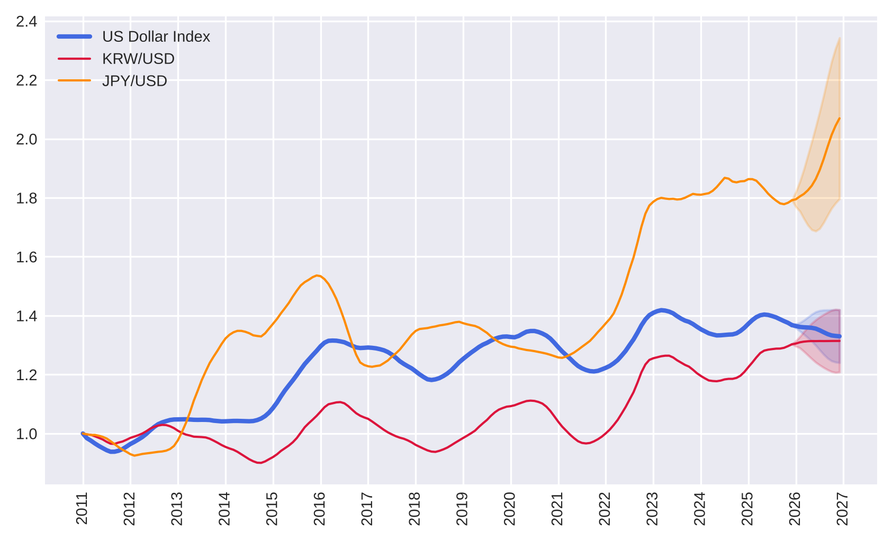

# Graph Neural Network-based Multi-Currency FX Forecasting

This is a Python implementation of a Bayesian multi-task graph neural network (B-MTGNN) framework for forecasting foreign exchange (FX) rates and related economic indicators. The structure follows [Cyber-trend-forecasting](https://github.com/zaidalmahmoud/Cyber-trend-forecasting), on which the model code is based.

The repository covers data, model training with hyper-parameter selection, evaluation, and 12-month forecasts for 2026.

## Repository structure

```
├── Dataset/                  # Raw collected monthly sources (2011-01 ~ 2025-12)
├── B-MTGNN/                  # Model code, model input data, trained model and outputs
│   ├── data/                 # Model inputs (data.csv, data.txt, sm_data.csv, graph.csv)
│   ├── model/Bayesian/       # Trained model (model.pt, hp.txt) and all outputs
│   │   ├── Validation/       # 2024 validation plots and metrics
│   │   ├── Testing/          # 2025 test plots and metrics
│   │   ├── forecast/         # 2026 forecasts (data/, gap/, plots/, pt_plots/)
│   │   └── graph_analysis/   # Learned adjacency matrix analysis
│   └── *.py
└── Comparative_Evaluation/   # Saved 2025 predictions and metrics of the baseline models
```

## Dataset

Monthly data for the US, Korea and Japan from January 2011 to December 2025 (33 variables). The targets are the US Trade Weighted Dollar Index, USD/KRW and USD/JPY. The other variables are returns, spreads and correlations between the three currencies, and macroeconomic indicators of each country (interest rate, GDP, CPI, employment, unemployment, trade balance). See [Dataset](Dataset/README.md).

## Modelling and future forecast

The directory **B-MTGNN** contains the model (MTGNN extended with Monte Carlo dropout for epistemic uncertainty), training and evaluation, and the 2026 forecast. See [B-MTGNN/README.md](B-MTGNN/README.md) for how to run each step.

- Train: 2011-01 ~ 2023-12, validation: 2024-01 ~ 2024-12, test: 2025-01 ~ 2025-12
- Input sequence length: 24 months, monthly one-step prediction
- Metrics: RRSE (Root Relative Squared Error) and RAE (Relative Absolute Error)

<p align="center">
  
</p>

## Comparative evaluation

The directory **Comparative_Evaluation** contains the saved 2025 predictions and the comparison table of B-MTGNN against Naive-last, Drift, AR, LSTM, GRU, TCN, Transformer and MTGNN, together with direction accuracy and F1 scores. See [Comparative_Evaluation/README.md](Comparative_Evaluation/README.md).

## Requirements

Python 3.10+ with the packages in [B-MTGNN/requirements.txt](B-MTGNN/requirements.txt).

```bash
pip install -r B-MTGNN/requirements.txt
```
